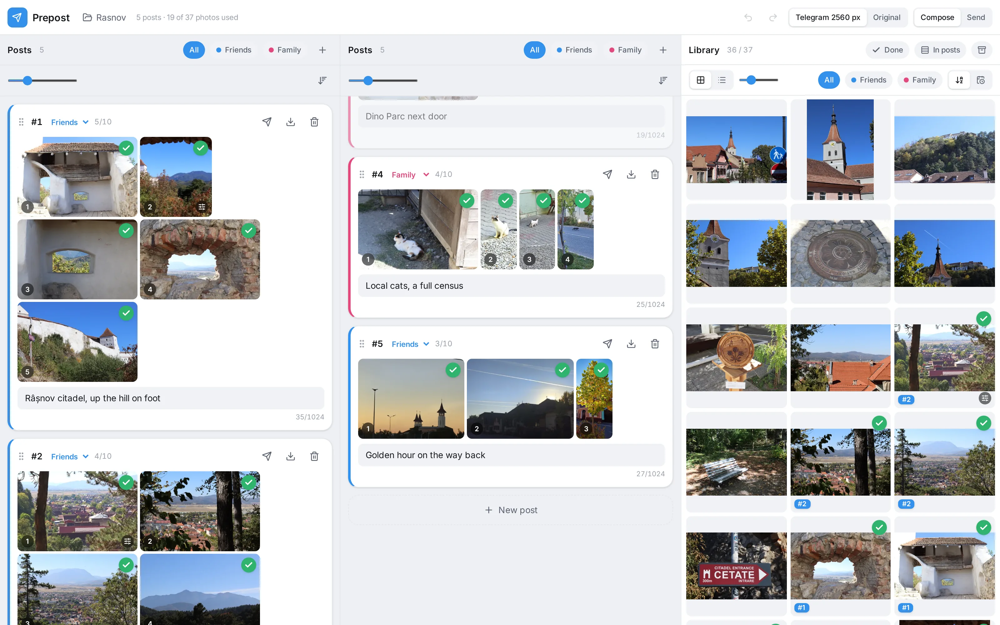
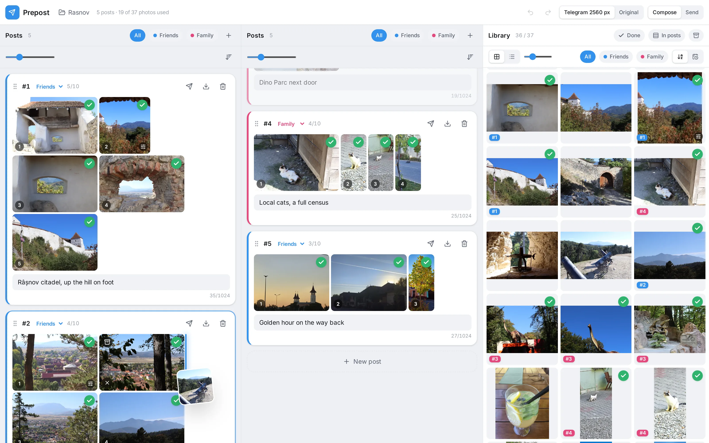
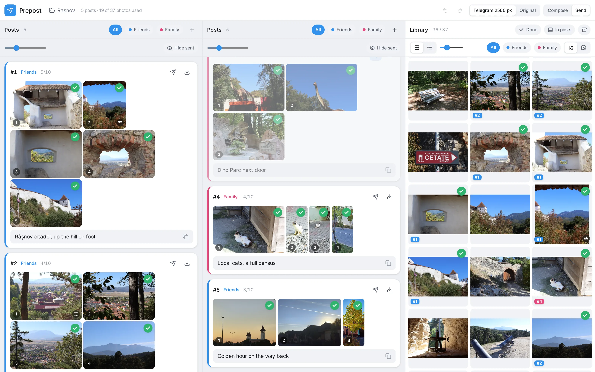
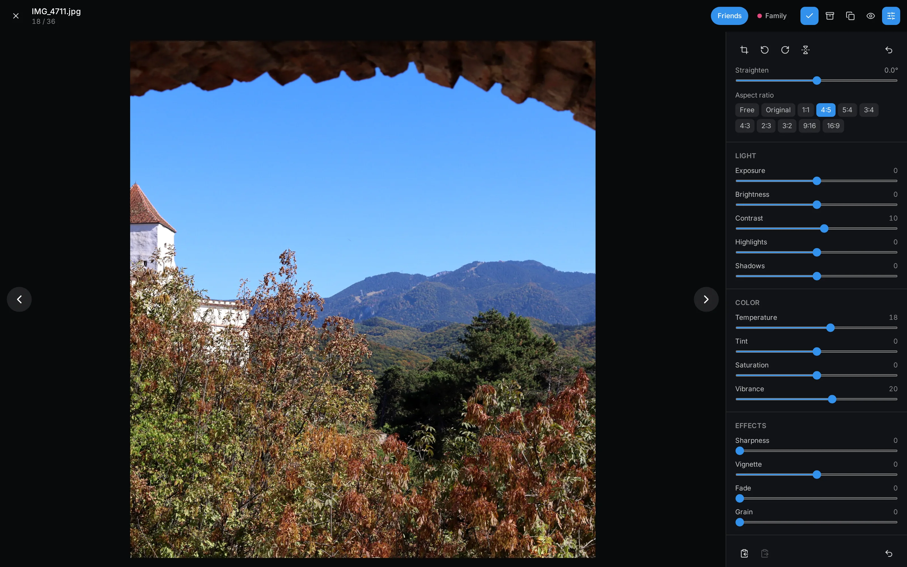
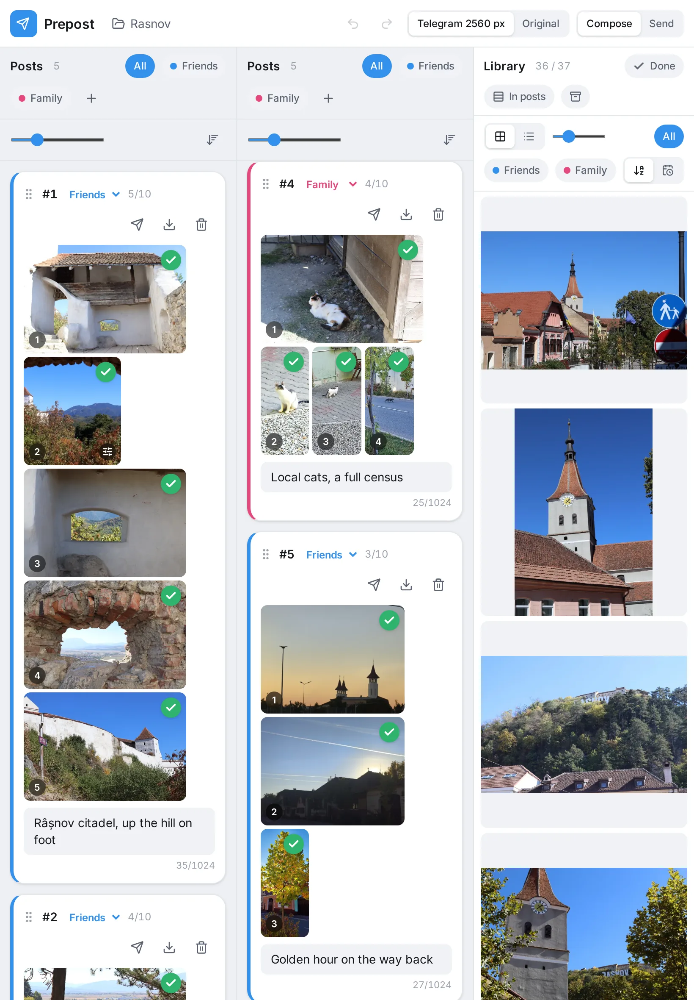

# Prepost

**Plan Telegram photo posts from a folder, then copy them into Telegram one click at a time.**

Telegram has no good way to prepare an album. You end up planning it in Saved Messages, where putting a photo in the middle means re-sending half the album. Prepost gives you a proper desk instead: open a folder, sort photos into posts of up to ten, write captions, crop and grade, and when it is time to post, click a photo or caption to copy it straight into Telegram.



## What it does

- **Two post panes and a library.** Each pane scrolls on its own, so you can compare the start of the plan with its end, or keep the post you are building next to the one you are taking photos from. The library is a grid or a list at any zoom, and it marks which post each photo is already in.
- **Drag anything anywhere.** Drop a photo into a post at an exact position, between two posts to start a new one, or back into the library. Posts reorder by their handle. The drop target is resolved instantly and highlighted without moving anything around until you let go.
- **Albums of 1–10 with captions.** Every post has a category (Friends, Family, or your own), a caption with Telegram's 1024-character limit, and a sent mark.
- **Non-destructive edits.** Crop with aspect presets, straighten, rotate, flip, plus exposure, brightness, contrast, highlights, shadows, temperature, tint, saturation, vibrance, sharpness, vignette, fade and grain. Edits are settings, not baked pixels: reopen a photo later and adjust or reset any of them. Thumbnails show the edited result.
- **Checkmarks and archive.** Tick photos you have decided on and hide the ticked ones, or archive the misses so they stop cluttering the library.
- **Send mode.** Click a photo to copy the edited image to the clipboard at Telegram's 2560 px (or the original size), click a caption to copy the text, mark the post sent, next.
- **Your folder is the database.** Everything is saved to `.tgprep.json` inside the folder you opened, with undo and redo. Photos never leave your machine: the server only serves the app.

| | |
|---|---|
|  |  |
| Drag a photo between two photos of a post | Send mode: click to copy, then paste into Telegram |



<p align="center"></p>

## Keyboard

| | |
|---|---|
| `←` `→` | previous / next photo in the viewer |
| `E` | edit panel |
| `R` | crop |
| `\` (hold) | compare with the original |
| `C` or `Space` | toggle the checkmark |
| `A` or `Delete` | archive and go to the next photo |
| `1`–`9` | set the photo's category |
| `Ctrl/⌘ C` | copy the edited photo |
| `Ctrl/⌘ Z`, `Ctrl/⌘ Shift Z` | undo, redo |
| `Esc` | close |

## Browser support

Prepost reads and writes the folder through the [File System Access API](https://developer.mozilla.org/docs/Web/API/Window/showDirectoryPicker), so it needs a Chromium-based desktop browser: Chrome, Edge, Brave, Arc, Opera. Firefox and Safari don't have it yet.

## Running it

It is a static WebAssembly app plus a small Rust server that serves it. Build both and start the server:

```sh
crates/web/build.sh                  # writes dist/: the UI and the image worker as wasm, Tailwind CSS, hashed names
cargo build --release -p tgprep-server
TGPREP_LISTEN=127.0.0.1:5180 TGPREP_CLIENT_DIR=dist target/release/tgprep-server
```

Then open http://127.0.0.1:5180. Set `TGPREP_TLS_CERT` and `TGPREP_TLS_KEY` (PEM) to serve HTTPS. The build needs the `wasm32-unknown-unknown` target, `wasm-bindgen-cli` matching the `wasm-bindgen` version in `Cargo.lock`, `wasm-opt` from Binaryen and the standalone `tailwindcss` binary. [docs/rust.md](docs/rust.md) has the details, tests and design notes.

## How it is built

Everything is Rust:

| crate | |
|---|---|
| `crates/model` | the `.tgprep.json` document, post operations and crop geometry, shared by the UI and the worker |
| `crates/web` | the UI in [Leptos](https://leptos.dev), rendered in the browser; edits are drawn by a WebGL2 shader |
| `crates/worker` | a Web Worker in WebAssembly that decodes photos and renders thumbnails off the main thread with the browser's own decoders |
| `crates/server` | an axum server that serves `dist` from memory, compressed, with immutable caching for hashed assets |

Prepost started as a TypeScript and React app and was ported to Rust with the same look and behaviour. Old `.tgprep.json` files are read and rewritten byte for byte, the Playwright suite written for the TypeScript app passes on both, and side-by-side screenshots match. On 300 photos of 6000×4000 px the Rust version shows the first thumbnails of a new folder about 3× sooner. Scrolling, dragging, editing and the viewer are within a few milliseconds of the original, copying in send mode is a few tens of milliseconds behind, and the larger WebAssembly bundle makes the very first visit over a slow connection about 140 ms slower. The measurements and how they were taken are in [docs/parity.md](docs/parity.md).

```sh
cargo test --workspace               # model, worker and server
bun install && bunx playwright test  # end-to-end in Chromium against the Rust build
```

## License

[MIT](LICENSE)
